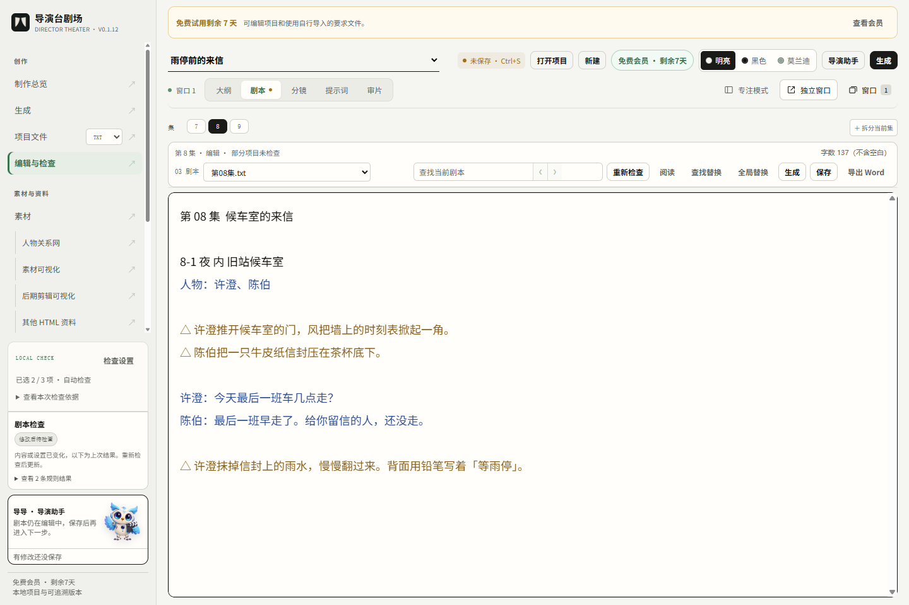
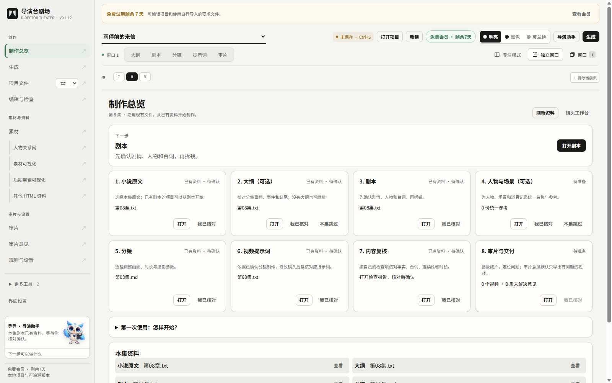
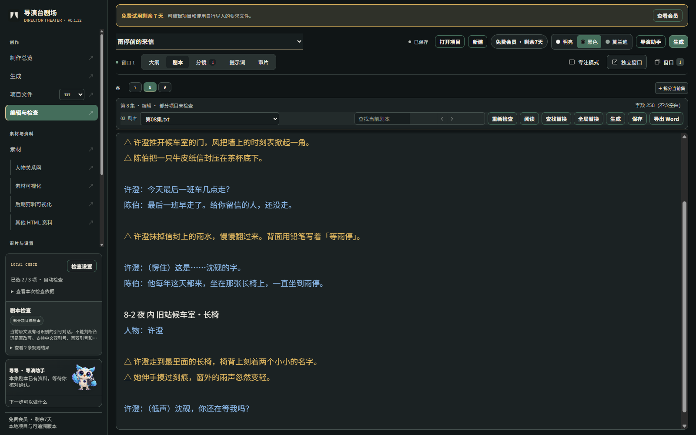
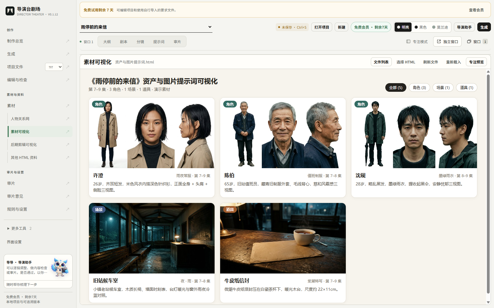
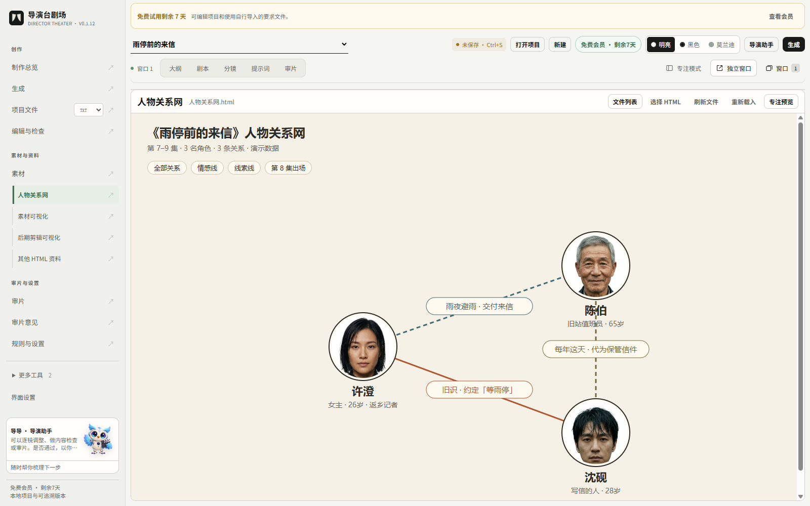
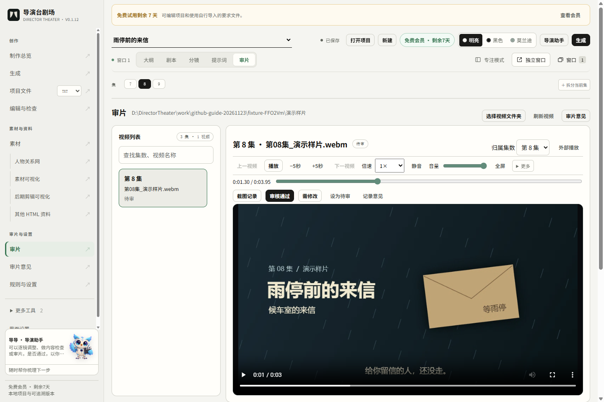
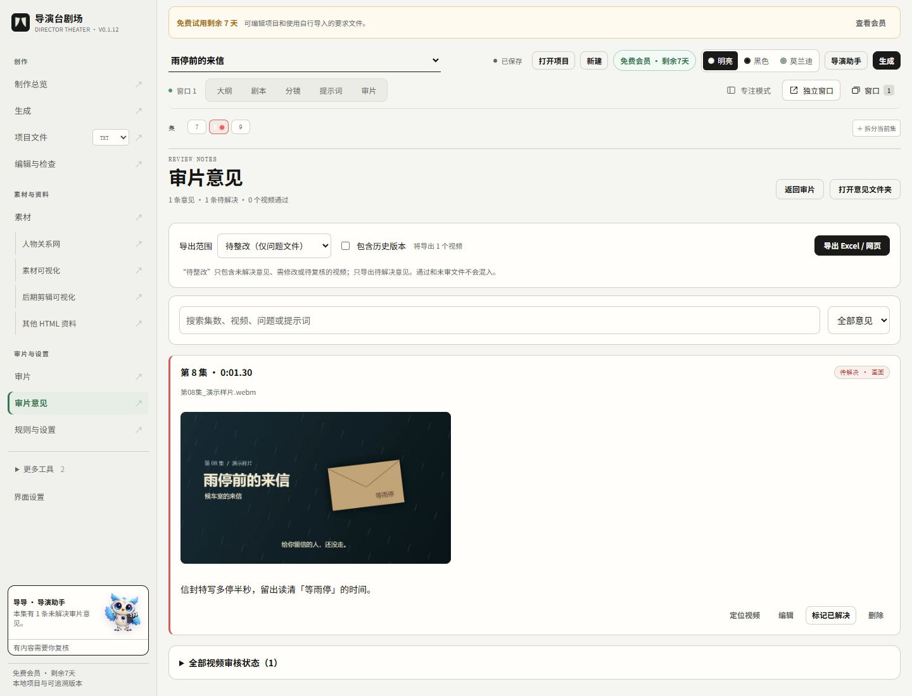

<div align="center">


# 导演台剧场 · Director Theater

**面向短剧与 AI 漫剧制作人员的 Windows 桌面工作台——从改稿到审片，专注这一集。**

[](https://director-theater-share.shanxixi0329.chatgpt.site/#demo)
[](https://github.com/shanxixi0329-dev/DirectorTheater/releases/latest)
[](docs/activation.md)

[官网与视频演示](https://director-theater-share.shanxixi0329.chatgpt.site/#demo) · [下载 Windows x64 安装包](https://github.com/shanxixi0329-dev/DirectorTheater/releases/latest) · [图文上手](docs/quickstart.md) · [会员激活](docs/activation.md) · [常见问题](docs/faq.md)

</div>

---

## 为什么做导演台剧场？

一部短剧动辄几十集，每一集都有原文、大纲、剧本、分镜、视频提示词、角色与场景设定，还有一轮又一轮的样片审片意见。文件散落在十几个文件夹里时，改一句台词往往要来回翻遍所有窗口。

**导演台剧场把全流程收进同一张本地工作台**：

- 改第 8 集剧本时，顶部一键切大纲、分镜与提示词，也可以把大纲拖成**独立窗口双屏对照**。
- 样片回来后，在工作台里直接播放定位、**一键截图记下时间点和修改意见**，复审时点一下即可跳回原位置，还能把待整改项一键导出为 **Excel 与离线网页**发给制作同事。
- **所有剧本、分镜与素材均直接读写你自己的项目文件夹**，不绑定云端；普通保存不会覆盖原有 Word 文件。

> **想先看动态演示？** 访问官网演示页：[https://director-theater-share.shanxixi0329.chatgpt.site/#demo](https://director-theater-share.shanxixi0329.chatgpt.site/#demo)

---

## 界面预览

以下截图均来自虚构演示项目《雨停前的来信》第 8 集实机运行画面：



<table>
  <tr>
    <td width="50%">
      
      <p align="center"><b>制作总览</b> · 原文到审片八步流程按集归档</p>
    </td>
    <td width="50%">
      
      <p align="center"><b>三套护眼主题</b> · 明亮 / 黑色夜间 / 莫兰迪一键切换</p>
    </td>
  </tr>
  <tr>
    <td width="50%">
      
      <p align="center"><b>素材可视化</b> · 角色三视图、场景与道具一屏查阅</p>
    </td>
    <td width="50%">
      
      <p align="center"><b>HTML 人物关系网</b> · 改稿时随时对照人物与剧情线</p>
    </td>
  </tr>
  <tr>
    <td width="50%">
      
      <p align="center"><b>时间点审片</b> · 播放定位问题帧，一键截图记录</p>
    </td>
    <td width="50%">
      
      <p align="center"><b>复审与整改交付</b> · 定位回看、标记已解决、导出 Excel / 网页</p>
    </td>
  </tr>
</table>

👉 [跟着完整截图教程，4 步走完新建项目到审片导出](docs/quickstart.md)

---

## 核心功能

- **按集编辑与快捷切集**：在原文、大纲、剧本、分镜表格和提示词之间一键切换。正文独立滚动、语义分色高亮、实时统计字数；支持**鼠标侧键切换上下集**（后退 = 上一集，前进 = 下一集），未保存时切集前自动提醒。
- **多窗口双屏对照**：点击「独立窗口」或拖出标签，把大纲、剧本、分镜、提示词或审片页开成独立窗口，各窗口保持各自页面与集数，双屏对照改稿更顺手。
- **三套主题与专注模式**：提供明亮、黑色夜间、莫兰迪护眼三套主题，支持一键收起侧栏进入全宽专注模式。
- **素材归档与 HTML 可视化**：按当前集数自动匹配角色、场景、道具提示词；可在工作台内直接打开人物关系网、素材可视化、后期剪辑可视化等本地 HTML 资料。
- **按自己的规则 AI 协同生成**：在规则页导入自己的剧本、分镜或提示词要求文件，配置 AI 服务后按步骤单集生成或批量生成。
- **时间点审片与整改交付**：在样片播放位置一键截图，自动带入秒数与画面并分类记录意见；复审时一键定位回看、标记已解决，并可按「待整改（仅问题文件）」范围导出 Excel 与离线网页。
- **全局安全替换与本地掌控**：跨集全局替换支持先预览命中位置、逐文件勾选、替换前自动备份与随时一键撤销；全部项目文件保存在本地或共享目录中。

---

## 快速开始

1. **看演示或下安装包**：可先在[官网演示页](https://director-theater-share.shanxixi0329.chatgpt.site/#demo)快速预览，再前往 [Releases 最新版本页](https://github.com/shanxixi0329-dev/DirectorTheater/releases/latest)下载 `DirectorTheater-Setup-*-win-x64.exe`（建议配合同页 `SHA256SUMS.txt` 校验文件完整性）。
2. **创建或打开项目**：支持「打开已有项目」「从一个文件开始」「从空白开始」三种入口，选中集数即可开始工作。
3. **可选进阶配置**：使用 AI 生成前，在应用内配置所需服务并在规则页导入要求文件；制作台绑定视频读取时长时，请将 FFmpeg 的 `ffprobe` 加入系统 `PATH`。

公开版首次使用提供 **7 天编辑试用**。试用到期后仍可正常打开和阅读项目，导入有效授权后可恢复编辑。[查看会员激活步骤](docs/activation.md)

---

## 问题反馈

遇到问题或有功能建议，欢迎在 [GitHub Issues](https://github.com/shanxixi0329-dev/DirectorTheater/issues) 提交，附上软件版本、Windows 版本、操作步骤与具体报错。截图时请使用演示资料，或遮住项目名称、API 密钥、电脑识别码和激活码。

---

## 从源码运行与打包

环境要求：Windows x64、Node.js 24 与 npm。

```powershell
npm ci
npm run check
npm start
```

运行 `npm run package:win` 可生成本地测试用 Windows 安装程序（输出位于 `installer-output/`）；正式签名发布请使用 `npm run package:win:signed`，详见 [Windows 签名发布说明](docs/windows-release.md)。

## 跨电脑同步

本仓库用于源码与版本管理。另一台电脑可通过 `git clone` / `git pull` 同步源码，普通用户直接到 [Releases](https://github.com/shanxixi0329-dev/DirectorTheater/releases/latest) 下载安装包即可。

应用直接读取你选择的项目目录。跨电脑继续制作时，复制完整项目目录或打开有权限的共享文件夹；AI 服务连接与本机应用授权在各台电脑内单独配置。
