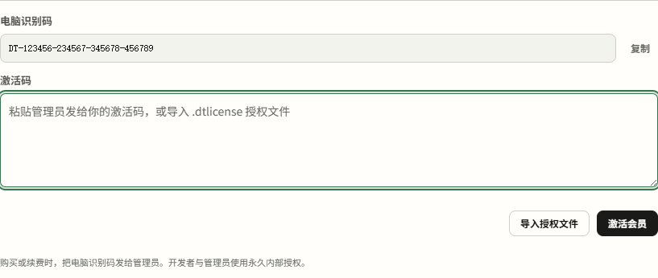

# 会员激活

[官网与视频演示](https://director-theater-share.shanxixi0329.chatgpt.site/#demo) · [下载最新版](https://github.com/shanxixi0329-dev/DirectorTheater/releases/latest) · [图文上手](quickstart.md) · [常见问题](faq.md) · [返回项目首页](../README.md)

公开版首次使用有 7 天编辑试用。试用到期后仍可阅读项目。Plus、Pro 和永久会员通过本机的授权文件激活。

## 在软件里导入授权

1. 安装或更新到 V0.1.13 或支持该授权的更高版本。在软件右上角点会员按钮，或在试用提示里点 **查看会员**。[下载 Windows 安装程序](https://github.com/shanxixi0329-dev/DirectorTheater/releases/latest)
2. 在会员中心找到 **电脑识别码**，点 **复制**，私下发给负责发放授权的管理员。
3. 收到 `.dtlicense` 后，在会员中心点 **导入授权文件**，选中收到的文件。收到激活码文本时，可以粘贴到 **激活码** 输入框，再点 **激活会员**。
4. 在会员中心核对当前身份、有效期和 **可编辑** 状态。

授权与发证时的电脑识别码关联。换电脑后，用新机器上的识别码联系管理员。反馈问题时请遮住识别码和激活码。

## 管理员签发工具

发布页的 `DirectorTheater-Membership-Tool-0.1.13.zip` 是管理员工具。外层 ZIP 解压后，双击 `Open-Membership-Tool.cmd`。密码窗口会提示 **发布者生日，6 位数字（YYMMDD）**。也可以用 7-Zip 直接打开里面的加密 `.7z`。[打开发布页](https://github.com/shanxixi0329-dev/DirectorTheater/releases/latest)

解压后阅读 **管理员说明.txt**。在装有 Node.js 24、保存了配套签发私钥的管理员电脑上，运行 **生成会员授权.cmd**，按提示输入计划和用户电脑识别码，再把生成的 `.dtlicense` 发给对应用户。

压缩包密码用于解压工具。发证还需要本机保存的配套私钥。新工具签发的文件可在 V0.1.13 使用，V0.1.13 仍支持旧版有效授权。

## 常见激活问题

- **授权文件与当前电脑不匹配**。核对是否用这台电脑上的识别码申请。
- **授权签名无效**。核对软件版本，并向管理员重新索取授权原文件。
- **会员已到期或尚未生效**。核对系统日期时间和授权有效期。
