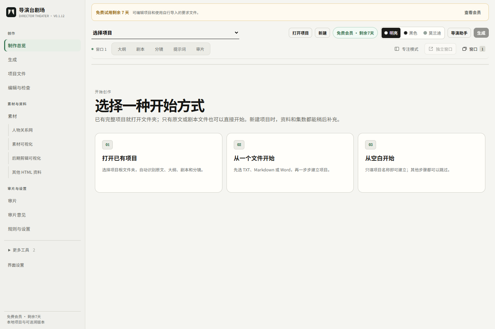
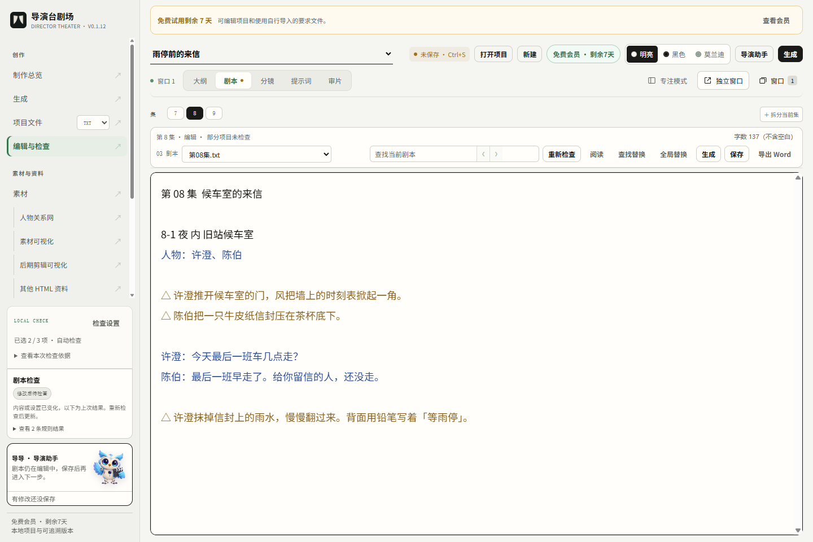
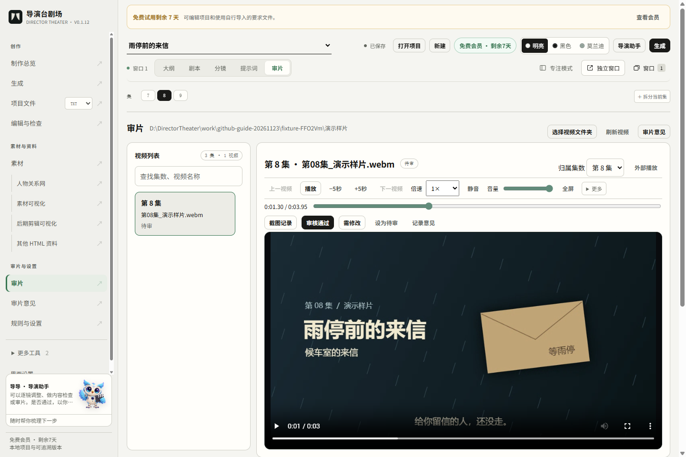
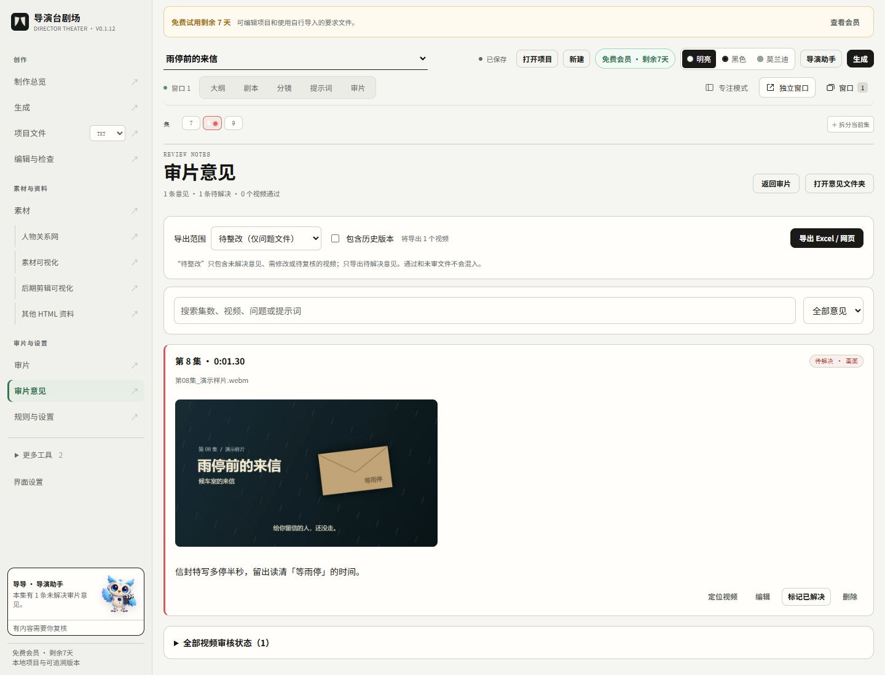

# 导演台剧场图文上手

用示例项目《雨停前的来信》第 8 集走一遍改稿和审片。以下以 Windows 公开版为例，剧本和样片均为虚构演示内容。

[官网与视频演示](https://director-theater-share.shanxixi0329.chatgpt.site/#demo) · [下载 Windows x64 安装程序](https://github.com/shanxixi0329-dev/DirectorTheater/releases/latest) · [返回项目首页](../README.md)

## 1. 打开或创建项目

- 已有项目目录，点 **打开已有项目**，选择项目根文件夹。
- 手头有一份原文或剧本，点 **从一个文件开始**，选择 TXT、Markdown 或 Word 文件。
- 新作品点 **从空白开始**，填写项目名称。已有资料可以在向导里带入，也可以之后补充。最后确认起始集和计划集数，点 **创建项目**。

## 2. 改稿并保存

在顶部选择 **剧本**，再选要编辑的集数。图里打开的是第 **8** 集。修改正文后，点顶部的 **保存**，也可以按 `Ctrl+S`。鼠标的后退侧键切到上一集，前进侧键切到下一集。

需要边看大纲边改剧本时，打开大纲页后点 **独立窗口**，把大纲和剧本分别放在两个窗口。

## 3. 播放到问题位置并截图

点左侧 **审片**，再点 **选择视频文件夹**。从视频列表选中样片，确认 **归属集数**。播放到要改的地方，点 **截图记录**。

截图后，表单会带入当前秒数和画面。选择问题类型，写明要改什么，再点 **保存意见**。示例里记录的是信封特写需要多停半秒。

## 4. 复审和导出

打开左侧 **审片意见**，找到待解决的条目。点 **定位视频** 可以回到对应时间点。确认改好后，点 **标记已解决**。

要把尚未解决的意见交给制作同事，选择导出范围 **待整改（仅问题文件）**，再点 **导出 Excel / 网页**。

